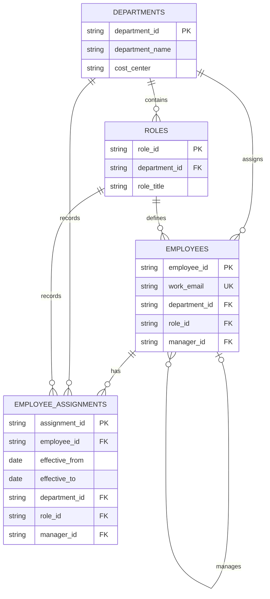

# LedgerForge — Organization ER Diagram

## Nullable columns: why they may be empty

- `manager_id` can be NULL when an employee has no manager assigned, such as the top-level leader.
- `exit_date`, `resignation_date`, `exit_type`, and `exit_reason` can be NULL while an employee is still employed or when exit details are not applicable.
- `effective_to` can be NULL for the current employee assignment because it has no known end date yet.
